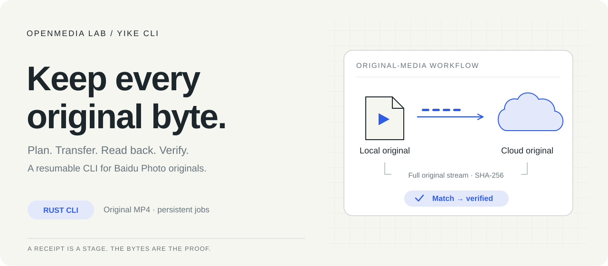

<p align="center">
  
</p>

<h1 align="center">Yike CLI</h1>
<p align="center"><strong>Original media. Resumable transfers. Verified bytes.</strong></p>
<p align="center">A Rust CLI for your own Baidu Photo (一刻相册) library.</p>
<p align="center">
  <a href="README_ZH.md">中文</a> ·
  <a href="#quick-start">Quick start</a> ·
  <a href="https://github.com/OpenMedia-Lab/yike-cli/releases/latest">Download</a> ·
  <a href="docs/usage.md">Command guide · 中文</a> ·
  <a href="CONTRIBUTING.md">Contribute</a>
</p>

Upload your original MP4 files, resume interrupted jobs, and retrieve cloud originals.
A backup becomes **verified** only after the cloud's complete original stream matches
the immutable local SHA-256. An upload receipt alone is a different state.

- **Keep the originals:** no transcoding, splitting or source deletion.
- **Pick up where you stopped:** durable plans and jobs; resume from server-reported missing parts.
- **Know what completed:** separate uploaded, blocked and verified items; export a JSON report.

The hero illustrates the workflow; it is not a capture of an account or transfer.

## Quick start

### 1. Download and check locally

Get the archive for your system from [Releases](https://github.com/OpenMedia-Lab/yike-cli/releases/latest),
check it against the accompanying `SHA256SUMS`, and extract it. Rust is not required
to run a prebuilt binary.

```sh
./yike --version
./yike doctor --offline
./yike --help
```

The offline check does not sign in or contact Baidu. A fresh local state reports
`session_saved: false` and `local_verified_receipts: 0`—expected before your first backup.
It creates the CLI's local state directory.

<details>
<summary>Choose a platform or build from source</summary>

| System | Archive target | Executable |
| --- | --- | --- |
| Windows x64 | `x86_64-pc-windows-msvc` · `.zip` | `.\yike.exe` in PowerShell |
| Linux / WSL x64 | `x86_64-unknown-linux-gnu` · `.tar.gz` | `./yike` |
| Linux ARM64 | `aarch64-unknown-linux-gnu` · `.tar.gz` | `./yike` |
| macOS Apple Silicon | `aarch64-apple-darwin` · `.tar.gz` | `./yike` |
| macOS Intel | `x86_64-apple-darwin` · `.tar.gz` | `./yike` |

WSL uses the Linux build. For a source install, use the Rust toolchain described
in the [build and release guide](docs/releasing.md):

```sh
git clone https://github.com/OpenMedia-Lab/yike-cli.git
cd yike-cli
cargo install --path . --locked
yike doctor --offline
```

SQLite is bundled. Windows source builds require the MSVC C++ tools; release
binaries do not. Platform compatibility, checksum commands and native build
validation are documented in the [release guide](docs/releasing.md).

</details>

### 2. Sign in and browse

Once `yike` is on your PATH (or use `./yike` beside the extracted binary):

```sh
yike auth login
yike auth status
yike albums list
yike files search 'camera' --kind video
```

Scan the normal sign-in QR code in the dedicated browser window. macOS/Linux use
a dedicated browser profile; WSL connects to Windows Edge. Credentials stay in the
CLI's private local state. [Login and state-directory details →](docs/usage.md#登录)

### 3. Plan one original, then run it

```sh
yike upload plan '/media/originals/sample.mp4' --album 'Originals' --expect-files 1
# Use the plan_id returned above:
yike upload run PLAN_ID
# Use the job ID returned by the run:
yike report JOB_ID --json > report.json
```

Planning inventories and hashes the local file without creating cloud objects.
`upload run` performs the transfer and, by default, streams the cloud original
back to compare SHA-256 without saving a second complete local copy. That readback
uses roughly one original's worth of download traffic.

Start with a small MP4. The default ceiling is **5 GiB per video**, or a smaller
account-reported limit. Blocked or unresolved items keep a batch partially complete.
The explicit large-file attempt option and its limits are in the
[upload guide](docs/usage.md#上传先计划再执行).

## What do you want to do?

| Task | Start here |
| --- | --- |
| Resume an interrupted transfer | `yike jobs status JOB_ID` → `yike jobs resume JOB_ID` |
| Recheck already uploaded originals | `yike verify JOB_ID` |
| Find and download an original | `yike files search 'camera' --kind video` → `yike download plan --id FILE_ID --to '/chosen/output'` → `yike download run PLAN_ID` |
| Back up a dated directory or run in the background | [Upload and launcher guide · 中文](docs/usage.md) |
| Understand protocol and verification boundaries | [Protocol notes](docs/protocol.md) |
| Build, test or package a release | [Contributing](CONTRIBUTING.md) · [Releasing](docs/releasing.md) |

Downloads resume into a `.part` file, check the original's size and MD5, and publish
the final file without overwriting an existing destination. Source-plan readback
adds the original local SHA-256 comparison. [Download details · 中文 →](docs/usage.md#检索和原件下载)

## Fits your workflow

- **CLI and scripts:** JSON stdout, progress on stderr, persistent jobs and completion scripts.
- **Personal archives:** keep original MP4 bytes and distinguish uploaded from verified.
- **Interrupted sessions:** resume an existing job rather than start the batch again.

This is an independently implemented, unofficial client using Baidu Photo's web
contracts; service changes can require adapter updates. It does not delete cloud
objects or local originals and does not provide mirror-delete synchronization.

Part of [OpenMedia-Lab](https://github.com/OpenMedia-Lab). Own implementation: [MIT](LICENSE).
